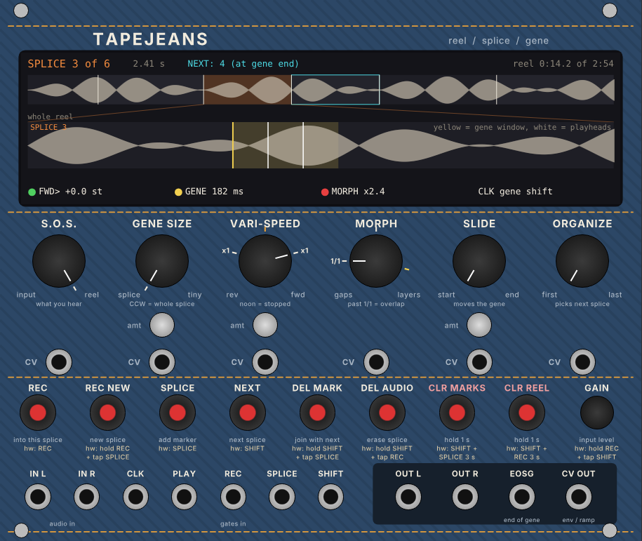

# Tapejeans

A VCV Rack 2 module for learning a tape and microsound module (the Make Noise
Morphagene) by seeing it. It records a **reel**, cuts it into **splices**, and
plays them back as **genes**, with the same controls as the hardware. The
hardware's button combinations each get their own labelled button, and a
display shows what is going on.

This is an independent study module. It is not made by or connected with Make
Noise.

## The words

| Word | Meaning |
|---|---|
| **Reel** | The whole recording, up to 2.9 minutes (2:54). On the hardware, one `mgX.wav` file on the SD card |
| **Splice** | A section of the reel between two markers. Up to 300 per reel |
| **Gene** | The bit of the splice that actually plays. Gene Size sets how long it is, and Slide sets where it starts. Morph sets how genes repeat and overlap |

## The display

- **Top line:** the splice that is playing and its length. **NEXT** (cyan) shows a splice that is waiting to take over at the end of the current gene. On the right are the record state, the reel length, or a short message after each button press.
- **Whole reel strip:** every splice. The current one is orange, the next one has a cyan outline, white lines are playheads, and a red line is the record head.
- **Splice zoom:** just the current splice. The yellow box is the gene window (Slide moves it, Gene Size resizes it). White lines are the playing genes, up to four at once.
- **Bottom line:** what the hardware's coloured lights would tell you. Vari-Speed's dot is red when stopped, green at original speed, blue at +1 octave and peach at -1 octave. Morph's dot is amber at 1/1, red for gaps or overlap, and blue in time stretch. It also shows the gene length and what the clock is doing.

## Knobs

| Control | What it does | CV |
|---|---|---|
| **S.O.S.** | What you hear and what recording writes: CCW = only the input, CW = only the reel. In between, new sound layers over the old ("sound on sound") | 0-8 V scales the knob (normalled to 8 V) |
| **Gene Size** | CCW = the whole splice plays. Turning CW shrinks the window down to about 2 ms | 0-8 V, with **amt** attenuverter |
| **Vari-Speed** | Noon = stopped. CW = forward, CCW = reverse. The `x1` marks (about 2:30 and 9:30) are original speed. Full CW = +12 semitones, near noon = -26 semitones | +-4 V sweeps the knob, with **amt** |
| **Morph** | CCW = silent gaps between genes. The `1/1` mark = genes join up seamlessly. Further CW = 2, 3, then 4 genes overlap. From about 1:00 they pan across the stereo field. Past the yellow mark (about 2:30), pitch layers appear | 0-5 V |
| **Slide** | Moves the gene window through the splice, straight away | 0-8 V, with **amt** |
| **Organize** | Picks the next splice. Splices are spread evenly across the knob, whatever their length. The change happens at the end of the current gene | 0-5 V |

## Buttons (and what you press on the hardware)

| Button | Does | On the hardware |
|---|---|---|
| **REC** | Record into the current splice. Recording keeps going round the splice until you press again (Time Lag Accumulation). S.O.S. sets how much old sound is kept | press **REC** |
| **REC NEW** | Record a new splice at the end of the reel. It plays as soon as you stop | hold **REC**, tap **SPLICE** |
| **SPLICE** | Put a marker where the playhead is now. While recording a new splice, the marker goes at the record head | press **SPLICE** |
| **NEXT** | Go to the next splice, at the end of the current gene | press **SHIFT** |
| **DEL MARK** | Remove the marker at the end of this splice, joining it with the next | hold **SHIFT**, tap **SPLICE** |
| **DEL AUDIO** | Erase this splice's audio from the reel | hold **SHIFT**, tap **REC** |
| **CLR MARKS** (hold 1 s) | Remove every marker and keep the audio | hold **SHIFT** + **SPLICE** for 3 s |
| **CLR REEL** (hold 1 s) | Erase the whole reel | hold **SHIFT** + **REC** for 3 s |
| **GAIN** | Input gain: -3 dB, 0 dB (modular level), +6 dB, +12 dB. The light above it is green for good level and red for too hot | hold **REC**, tap **SHIFT** (steps blue, green, orange, purple) |

If a clock is patched, REC and REC NEW wait for the next clock to start and
stop, and their light flashes while waiting. That matches the hardware.

## Jacks

| Jack | |
|---|---|
| **IN L / IN R** | Audio in. L alone feeds both sides |
| **CLK** | Each clock jumps to the next gene (**gene shift**). With Morph past 2 genes, the clock instead sets how fast you travel through the splice, while Vari-Speed only changes pitch (**time stretch**). Clocks also start and stop recording |
| **PLAY** | Normalled high (it loops). A rising edge restarts from the Slide point. Low = stop at the end of the gene |
| **REC / SPLICE / SHIFT** | Gates that do the same as the buttons |
| **OUT L / OUT R** | The S.O.S. mix of input and reel |
| **EOSG** | A 10 ms, 10 V gate at the end of each gene or splice |
| **CV OUT** | 0-8 V envelope follower of the output (or a ramp over each gene, from the menu) |

## Right-click menu

- **Load reel (.wav)** and **Save reel as .wav**. Files are saved as 48 kHz 32-bit float stereo, with splices as WAV cue markers, which is the hardware's format. Name a file `mg1.wav` to `mg9.wav` and put it in the SD card's root to try it on the hardware. I haven't been able to test that with a real card, so keep a backup of your card. Any WAV file loads, at any sample rate.
- **Keep the reel with the patch** (on by default): the reel is saved inside the patch.
- **Options**: the same settings as the hardware's `options.txt` file, with its option names in brackets: vari-speed mode (`vsop`), recording source (`inop`), organize timing (`omod`), smooth gene window (`gnsm`), PLAY mode (`pmod`), clock mode (`ckop`), CV output (`cvop`), Morph pitch layers (`mcr1`-`mcr3`), and what the REC gate does (`rsop`).

## Ten-minute tour (then try the same on the hardware)

1. Patch an oscillator or drum loop into **IN L** and set **S.O.S.** fully CCW. Press **REC NEW**, wait a few seconds, then press it again. The new splice plays. Turn S.O.S. CW to hear it.
2. Press **SPLICE** a few times while it plays to chop it up. Turn **Organize** and watch the cyan NEXT outline. It only moves when the current gene ends.
3. Turn **Gene Size** up. The yellow box shrinks and the sound starts to stutter. Move **Slide** to scan the box through the splice.
4. Turn **Morph** past `1/1` and watch the playheads multiply. Past the yellow mark, the pitch layers come in.
5. Patch a clock into **CLK**. With Morph low, each clock jumps to the next gene. Turn Morph past `x2` and the display says *time stretch*: now Vari-Speed only changes the pitch.
6. Set S.O.S. to noon and press **REC** while playing into it. Each pass layers on top of the last and slowly fades.

## Rig ideas

- **Clock from Live**, through the disting NT, into CLK. Genes lock to tempo, so microsound stays in the groove.
- **EOSG into DROID**: count genes to drive logic, such as flipping a Marbles mode every 8 genes or advancing a pattern.
- **Marbles or Random8 stepped voltage into Organize** to jump between splices. **K-Accumulator or a slow Pam's ramp into Slide** to scan.
- **Arrangement**: record a Hapax chord pad into four splices, one per section, and move Organize per section instead of looping one sound.

## Building

GitHub Actions tests the engine and builds the Apple Silicon version on every
push to main (see `.github/workflows/build.yml`). The `.vcvplugin` file appears
on this repository's **latest** release page. To build locally, download the
Rack SDK and run `make dist RACK_DIR=/path/to/Rack-SDK`.

The panel is drawn by `res/make_panel.py` (needs `pip install fonttools`). The
engine (`src/TapeEngine.hpp`) and the WAV code (`src/Wav.hpp`) have no Rack
dependencies. `test/engine_test.cpp` checks them offline: recording, splices,
Organize and Shift timing, Vari-Speed, Gene Size and Morph, editing,
sound-on-sound, clock gene shift and record sync, 44.1 kHz, auto-stop at
2.9 minutes, and WAV round trips with markers.

## Differences from the hardware

These are guesses where the manual gives no numbers, and simplifications
elsewhere:

- The shortest gene is 2 ms.
- Morph's landmarks are fixed knob positions: `1/1` at 9:00, panning from about 1:00, and pitch layers from about 2:30.
- At Gene Size CCW, a gene lasts one pass of the splice at the current speed.
- No phase-modulation input (`pmin`), and no multiple reels or Reel Mode. Use Load and Save instead.
- The reel uses about 67 MB of memory per module, because a full 2.9-minute reel is allocated up front.
